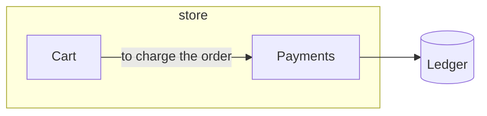

# summary

`summary` prints the plan as text: Markdown for a pull request, a README or
a chat, with a mermaid diagram at the end. It counts files and lines the way
`check` does, so the numbers are the same. It writes nothing and does not
read the page.

```sh
node docs/codeplan/codeplan.mjs summary [--mermaid]
```

## What it prints

For the example in [plan file](plan-file.md), in a repository where `cart`
has 2 files with 18 lines and `pay` has 1 file with 9 lines:

````markdown
# shop

The web shop. **Cart** sends orders to **Payments**, which records them in **Ledger**.

## Parts

| Part | Id | Zone | Files | Lines |
|---|---|---|---|---|
| Cart | cart | store | 2 | 18 |
| Payments | pay | store | 1 | 9 |

### Cart

Holds what a customer is about to buy.

Uses:

- **Payments**: to charge the order

### Payments

Charges cards and writes each charge to **Ledger**.

Uses:

- **Ledger**

## Externals

| External | Id | About |
|---|---|---|
| Ledger | ledger | The accounting service. |

## Scenarios

### One order is paid

1. **Cart**: Sends the basket total to **Payments**.
2. **Payments**: Charges the card.
3. **Ledger**: Keeps the charge.

## Tasks

| Task | Id | Status | Files | Parts |
|---|---|---|---|---|
| Refunds | refunds | doing | 0 of 1 | Payments |
| Basket total | basket-total | done | 1 of 1 | Cart |

## Diagram


````

- The title is the plan's `name`, or `codeplan` when that is empty. A part,
  external or scenario with an empty `name` is shown by its id.
- `{id}` in `about`, `why` and `does` becomes the target's name in bold. A
  reference to nothing stays as it is written.
- A planned part has `planned` in the Files and Lines columns.
- When there are orphans or unwatched files, a line after the parts table
  gives the number of each.
- The Tasks table has every task in plan file order, the `done` ones
  included. Files is `<n> of <m>`: how many of the paths in the task's
  `makes` are files in the repository; it is empty for a task with no
  `makes`. Parts has the names of the parts in the task's `parts`.
- A section with nothing in it is left out: no `about` paragraph (an
  `about` of only spaces, tabs or line breaks counts as nothing), no
  `Uses:` list, no Externals, Scenarios or Tasks section.
- Text from the plan file is written so that Markdown shows it as it is:
  line breaks become spaces, characters that Markdown reads as markup get
  a backslash, and an `about` paragraph loses the spaces and tabs at its
  ends.

The same plan file and the same code give the same bytes on every run.

## The diagram alone

`--mermaid` prints only the lines of the diagram, without the code fence:

```sh
node docs/codeplan/codeplan.mjs summary --mermaid > plan.mmd
```

- Parts are `p0`, `p1`, … and externals `x0`, `x1`, … in plan file order;
  zones are `z0`, `z1`, … in the order of their names. Ids from the plan
  file are not used as node names, so an id such as `end` is safe.
- Each use is one arrow, labelled with its `why` when there is one. Uses
  are drawn as written, a repeated use and a use of the part itself
  included.
- In labels, the characters mermaid reads as syntax (`"`, `#`, `%`, `&`,
  `<`, `>`, the backtick and `|`) are written as character codes such as
  `#37;`, which mermaid shows as the character.
- Scenarios are not in the diagram.
- A planned part has a dashed border.

## Findings and exit codes

`summary` checks the plan file as `check` does and prints the findings on
standard error, info findings included, each with its `fix:` line.

| Exit code | When |
|---|---|
| 0 | The text was printed. Warnings, orphans, contested and unwatched files do not change this. |
| 2 | Nothing was printed: the plan file has an error, there is no plan file, the config or plan file cannot be read, or an option is unknown. |

Because warnings do not change the exit code, use `check` in CI, not
`summary`.
